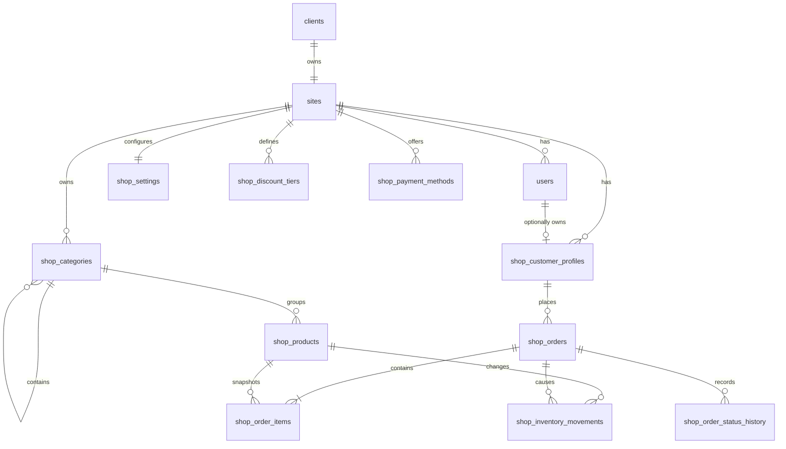

# Shop Database Design (Review Draft, revision 2)

## 0. What changed in this revision

This revision was checked against the confirmed Vue screens (`src/types/*.ts`, `src/stores/*.ts`,
`src/services/pricing.ts`, `src/services/repositories/*.ts`, the checkout, account, order and product views),
the existing `client-api` code (`routes/api.php`, `ResolveTenant`, `AttachmentService`, `config/attachments.php`)
and the media contract in `../media-api/attachment_integration.md`. The screens are final; only the data and
backend logic were changed. Items marked **[decision]** were confirmed on 2026-10-31 (see §13).

**Revision 3 (2026-10-31)** — all §13 points accepted with the recommended defaults; two stock switches added
(`shop_settings.deduct_stock_on_confirm`, `shop_products.unlimited_stock`) so stock can stay informational while
orders are confirmed over WhatsApp; §15 adds the owner/staff **edit mode** (login + add/update product card);
§16 lists the generated deliverables (schema SQL, seed SQL, frontend spec for Codex, backend prompt for Claude).

| # | Finding | Change in this revision |
| --- | --- | --- |
| 1 | The confirmed screens have **no login**. Checkout, account and order history work without an account, yet `GET /orders` and `PUT /customer/profile` must be scoped to one customer. | `shop_customer_profiles` now identifies a customer either by `user_id` (future login) or by a **guest token** issued by the API. Orders reference `customer_profile_id`. **[decision]** |
| 2 | `X-Client-Code` is the only tenant signal on public reads (no user). The previous draft said `site_id` must come from the authenticated user. | `site_id` is resolved from `X-Client-Code` -> `clients.client_code` -> `sites.id` for every request; authenticated management requests must additionally match `users.site_id`. |
| 3 | The account and checkout screens have **one free-text address field** (`Customer.address`, max 350 chars). The structured `shop_customer_addresses` table cannot be filled from it. | Dropped `shop_customer_addresses`; `shop_customer_profiles.address` is a nullable `text`. Structured addresses are listed as future work. |
| 4 | Quantities are **whole units** everywhere (cart rejects non-integers, `+`/`-` controls, "Baki 32 karton"). The draft used `decimal(12,3)`. | All quantity columns are integers. Line totals need no rounding. |
| 5 | `media_attachments.tenant_id` is **`clients.client_code`** (the `X-Client-Code` value), not the site id. Roles are `primary` (singleton, `slot = 'primary'`) and `gallery` (`slot = NULL`, ordered by `sort_order`), per `config/attachments.php`. The draft used role `image` and slots `gallery-01`. | §7 rewritten to the real contract; `category` added to the entity-type allowlist. |
| 6 | `Order.id` is shown as the heading, used in the route `/orders/:id` and printed in the WhatsApp message (`Rujukan: ...`). | `Order.id` is `shop_orders.reference_no`; the numeric id is internal. Reference format defined in §5. **[decision]** |
| 7 | Checkout sends the payment method **label** (`paymentOptions: string[]`), not a code. | API resolves the label against active `shop_payment_methods` and stores both code and label. |
| 8 | "Pilihan kami" (`sort=popular`) needs a deterministic order; the seed order is the implicit ranking. | Added `shop_products.sort_order`. |
| 9 | Low stock is `stock < 10` on the screen (strict). | `low_stock_threshold` comment changed to "below which"; derivation rules written out in §5. |
| 10 | Order cards render the product image or generated packshot (`OrderItem.image`, `OrderItem.art`). | Not snapshotted; resolved from the product at read time (products are soft-deleted, never removed). |
| 11 | Favourites and "Maklumkan apabila ada stok" are browser-only; no repository method calls an API. | `shop_favourites` moved to §6.11 (deferred). Stock alerts noted as future work. |
| 12 | Pricing, delivery fee, minimum order, status transitions and stock timing were described loosely. | Exact rules in §5 so the Laravel implementation reproduces `src/services/pricing.ts` and the local repository. |
| 13 | Guest-performed status changes need an audit actor. | `shop_order_status_history.actor_type` added. |
| 14 | At this stage orders are confirmed over WhatsApp; the owner may not want stock to move automatically, and some products have no meaningful stock count. | `shop_settings.deduct_stock_on_confirm` (owner switch, default off) and `shop_products.unlimited_stock` (per product). `Product.stock` becomes `number \| null`; §5.7. |
| 15 | The owner needs to add and update products from the same screens once logged in. | §15: `/login` for owner/staff, edit-mode toggle, an empty `[+]` card in the listing and an in-place card form (image, category, name, packing, price, original price, stock, minimum order, Simpan). |

## 1. Purpose

This document proposes the database structure for the LZHub wholesale shop shown by the current Vue screens. It is a
design for review only; it does not change `client-api` or create any database tables yet.

The design supports:

- an owner or staff member logging in and managing the shop;
- parent and child categories (stored; the current screens use a flat list);
- products, pricing, stock, promotion prices, and product details;
- product and category images through the existing `media_attachments` table;
- customer profiles (guest or logged in), checkout, and order history;
- site-level ordering rules, payment choices, and quantity discounts; and
- clean separation from a future booking application.

Sources reviewed:

- `/home/jul/Workspace/mybizgate/client-api/database/schema/00_main_structure.sql`
- `/home/jul/Workspace/mybizgate/client-api/config/attachments.php`, `app/Services/AttachmentService.php`,
  `app/Http/Middleware/ResolveTenant.php`, `routes/api.php`
- `/home/jul/Workspace/mybizgate/media-api/attachment_integration.md`
- `src/types/{product,category,order,client}.ts`, `src/services/pricing.ts`, `src/services/order.service.ts`,
  `src/services/repositories/{api,local}.repository.ts`, `src/stores/{cart,order,catalogue}.ts`,
  `src/utils/order-status.ts`, `src/services/whatsapp-message.ts`, and the views for catalogue, product, cart,
  checkout, account, orders and order detail.

## 2. Prefix, ownership and tenant resolution

Use the prefix **`shop_`** for every table owned by the commerce/catalogue domain.

| Domain | Prefix / tables | Reason |
| --- | --- | --- |
| Shared platform | `clients`, `sites`, `users`, `sessions`, `personal_access_tokens`, `media_attachments` | Already exists and should be reused by all application types. |
| Shop / catalogue | `shop_*` | Products, stock, customers, and orders belong to the commerce domain. |
| Future booking app | `booking_*` | Booking availability and appointments can be added later without mixing them with shop records. |

Do **not** create a separate `shop_users` login table. Authentication already belongs to `users`, where each user is
linked to a `site_id` and has the role `owner`, `staff`, or `customer`.

**Tenant resolution (every shop request).** The frontend sends `X-Client-Code` on every call (`src/services/http.ts`).
The API resolves it as `clients.client_code` -> `clients.id` -> `sites.id` (one site per client, `sites.client_id` is
unique) and uses that `site_id` for every query. If the client code is unknown, or `sites.status` is not `active`, the
API answers `404` (unknown) or `403` with `sites.status_reason` (expired/suspended).

`X-Client-Code` identifies the site; it is **never** authorisation:

- public catalogue reads (`/client/config`, `/categories`, `/products`) need nothing else;
- customer endpoints (`/customer/profile`, `/orders`) need a **customer identity**: a bearer token that is either a
  guest token (§5.6) or, later, a Sanctum token of a `users` row with role `customer`; the identity's `site_id` must
  equal the resolved site;
- management endpoints need a Sanctum token of an `owner`/`staff` user whose `users.site_id` equals the resolved
  site, otherwise `403`.

## 3. Entity overview



`media_attachments` remains the shared image link table and is therefore not duplicated as `shop_product_images`.

## 4. Proposed tables

### Core management tables

| Table | Purpose |
| --- | --- |
| `shop_settings` | One row per site containing currency, minimum order, delivery fee, WhatsApp ordering, and order reference settings. |
| `shop_categories` | Category tree (parent optional) with display order and publication status. |
| `shop_products` | Product catalogue details, wholesale pack information, prices, stock balance, catalogue ranking and publishing flags. |
| `shop_discount_tiers` | Site-wide, per-line quantity discounts such as 2% from 5 units and 4% from 10 units of the same product. |
| `shop_payment_methods` | Checkout choices such as cash on delivery and bank transfer. |
| `shop_inventory_movements` | Auditable stock additions and deductions. |

### Customer and ordering tables

| Table | Purpose |
| --- | --- |
| `shop_customer_profiles` | Shop customer identity (guest token or user) with the store details and single address shown on the account screen. |
| `shop_orders` | Order header, customer snapshot, fulfilment choice, totals, and current status. |
| `shop_order_items` | Immutable product and pricing snapshot for each order line. |
| `shop_order_status_history` | Audit trail of every order status change, including who caused it. |

### Deferred (not used by the confirmed screens)

| Table | Purpose |
| --- | --- |
| `shop_favourites` | Server-side favourites once customers log in. The screens keep favourites in browser storage today. |
| `shop_customer_addresses` | Structured, multiple delivery addresses. The screens have one free-text address. |
| `shop_stock_alerts` | "Maklumkan apabila ada stok" subscriptions. Browser-only today; no notification channel exists yet. |

## 5. Design rules

### 5.1 General

1. `site_id` is the tenant boundary. Every shop record is scoped to one site and every foreign key to another shop
   row or to `users` is composite on `(site_id, id)` so a row can never point into another site.
2. All money is stored as integer minor units: `14520` means MYR 145.20. This matches the frontend (`price`,
   `subtotal`, `total` are integer cents) and avoids floating-point errors.
3. All quantities (`minimum_order_quantity`, `stock_quantity`, `quantity`, tier thresholds, movement deltas) are
   **integers** in the product's selling unit (karton, guni). The cart store rejects non-integer quantities.
4. Product and category records use soft deletion. Orders remain historical records and are never physically
   deleted through application workflows.
5. Every proposed table and column has a SQL `COMMENT` value.

### 5.2 Derived product fields (not stored)

| Field | Rule (mirrors `src/data/seed/products.ts` and `src/services/pricing.ts`) |
| --- | --- |
| `stockStatus` | `in_stock` if `unlimited_stock = 1`; else `out` if `stock_quantity < minimum_order_quantity`; else `low` if `stock_quantity < low_stock_threshold`; else `in_stock`. |
| `stock` | `null` when `unlimited_stock = 1` (the frontend treats `null` as "no limit"), otherwise `stock_quantity`. |
| `promo` | `compare_at_price_minor IS NOT NULL AND compare_at_price_minor > selling_price_minor`. |
| `active` | `status = 'active' AND deleted_at IS NULL` and the category is `active` and not deleted. |
| `oldPrice` | `compare_at_price_minor` when `promo`, otherwise omitted. |
| `images[]` | media-api `view_url` of the `primary` attachment first, then `gallery` by `sort_order`. Empty array when none, so the frontend draws the packshot from `art`. |

When an owner lowers `compare_at_price_minor` to or below `selling_price_minor`, the API must clear it (set NULL)
rather than let the CHECK constraint reject the update.

### 5.3 Pricing (must reproduce `pricing.ts` exactly)

1. **Tier selection.** Load active `shop_discount_tiers` for the site. For an order line with quantity `q`, the
   applicable tier is the one with the **largest** `minimum_quantity <= q`; none if `q` is below every tier.
   Tiers are per line (per product), not cumulative, and never based on the cart total.
2. **Unit price.** `unit_price_minor = round(selling_price_minor * (10000 - discount_basis_points) / 10000)`,
   half up (`Math.round` in JS, `round()` in PHP give the same result for positive values). Without a tier,
   `unit_price_minor = selling_price_minor`.
3. **Line total.** `line_total_minor = quantity * unit_price_minor` (integers, no rounding).
4. **Subtotal.** `subtotal_minor = SUM(line_total_minor)`.
   `discount_minor = SUM(quantity * (base_price_minor - unit_price_minor))` (the "Penjimatan kuantiti" line).
5. **Minimum order.** Reject the order unless `subtotal_minor >= shop_settings.minimum_order_minor`
   (checked on the discounted subtotal, before delivery).
6. **Delivery fee.** `0` when `fulfilment_method = 'pickup'`; `0` when `free_delivery_from_minor IS NOT NULL AND
   subtotal_minor >= free_delivery_from_minor`; otherwise `shop_settings.delivery_fee_minor`.
7. **Total.** `total_minor = subtotal_minor + delivery_fee_minor` (enforced by CHECK).
8. The frontend sends only `{productId, qty}` per line; the API re-prices every line from the database and
   ignores any client-side amounts. The frontend `quantityDiscounts[].rate` is `discount_basis_points / 10000`.

### 5.4 Order validation at `POST /orders`

| Check | Rule | Frontend equivalent |
| --- | --- | --- |
| Product | exists in the site, `active` (§5.2), not deleted | `Produk ... tidak tersedia.` |
| Minimum qty | `qty >= minimum_order_quantity` | `minimum N unit` |
| Stock | `qty <= stock_quantity` unless `unlimited_stock = 1` (then no upper bound) | `stok tersedia N unit` |
| Store / contact | `store_name` and `contact_name` at least 2 characters (screen limits: 80 chars each) | `validateCustomer` |
| Phone | 9 to 15 digits after stripping non-digits (screen limit 20 chars) | `validateCustomer` |
| Address | required and at least 10 characters when `fulfilment_method = 'delivery'`; may be empty for pickup (screen limit 350 chars) | `validateCustomer` |
| Requested date | `>= today + 1 day` in the site's timezone (application rule; `CURDATE()` is not allowed in a CHECK) | `Pilih tarikh esok atau selepasnya.` |
| Payment method | the submitted label must equal the `label` of an active `shop_payment_methods` row of the site; store its `code` and `label` | select list from `paymentOptions` |
| Notes | optional, max 500 characters; API returns `""` for NULL | textarea `maxlength=500` |
| Items | at least one line | `Troli kosong.` |

### 5.5 Order reference and status workflow

**Reference.** `Order.id` in the API response is `shop_orders.reference_no`, and `GET /orders/{id}` and
`PATCH /orders/{id}/status` take the reference. Proposed format: `{reference_prefix}-{YYYYMMDD}-{NNNN}` where
`NNNN` is `shop_settings.next_order_number` zero-padded to 4 digits (grows past 4 digits naturally), reserved
with `SELECT ... FOR UPDATE` on the `shop_settings` row inside the order transaction. Example: `LZ-20261031-0017`.
The local prototype uses `LZ-YYYYMMDD-<random>`; only the suffix differs. **[decision]**

**Statuses** are exactly the frontend `OrderStatus` union: `draft_whatsapp`, `pending_review`, `confirmed`,
`processing`, `delivered`, `completed`, `cancelled`. Labels live in the frontend (`src/utils/order-status.ts`).

**Transitions.**

| Actor | From | To | Side effects |
| --- | --- | --- | --- |
| customer (`POST /orders`) | – | `draft_whatsapp` | insert order, items, first history row |
| customer ("Saya sudah hantar di WhatsApp") | `draft_whatsapp` | `pending_review` | set `whatsapp_sent_at` (customer's claim, not a WhatsApp receipt) |
| customer ("Batalkan rekod pesanan") | `draft_whatsapp`, `pending_review`, `confirmed`, `processing` | `cancelled` | set `cancelled_at`; release stock if it was deducted |
| owner/staff | `pending_review` | `confirmed` | set `confirmed_at`; deduct stock (§5.7) |
| owner/staff | `confirmed` | `processing` | – |
| owner/staff | `processing` | `delivered` | – |
| owner/staff | `delivered` | `completed` | set `completed_at` |
| owner/staff | any except `completed`, `cancelled` | `cancelled` | set `cancelled_at`; release stock if it was deducted |

Any other jump is rejected with `422`. `completed` and `cancelled` are terminal; a restore workflow is not designed.
Every change inserts one `shop_order_status_history` row with `actor_type` and, when known, `changed_by_user_id`.
Customers may only change their own orders (same `customer_profile_id`).

### 5.6 Customer identity without a login screen

The confirmed screens have no sign-in. To scope `GET /orders`, `GET /orders/{id}`, `PATCH .../status`,
`GET|PUT /customer/profile` to one customer, the API issues a **guest token**:

1. The first `PUT /customer/profile` or `POST /orders` without a bearer token creates a `shop_customer_profiles`
   row with a random 32-byte token; the response carries `guestToken` once (plain) and the row stores only
   `SHA-256(token)` in `guest_token_hash`.
2. The frontend stores the token through `src/services/storage.ts` and registers it with
   `http.setTokenProvider()` (already present in `src/services/http.ts`); every later customer call sends
   `Authorization: Bearer <token>`. No screen changes are needed.
3. A request with an unknown token gets `401`; the frontend already treats `401` on the profile as "no profile".
4. When customer login is added later, `shop_customer_profiles.user_id` is filled and the guest token can be
   revoked by clearing `guest_token_hash`. A profile must have at least one of the two (CHECK).

The account screen's note "disimpan pada browser ini sahaja" is UI copy and is left unchanged; in API mode the
profile is also stored on the server under the guest token. **[decision]**

### 5.7 Stock

The prototype does **not** change stock when a draft is saved (the local repository validates availability only).
Two switches decide what the API does; both default to the "WhatsApp stage" behaviour:

| Switch | Where | Default | Effect |
| --- | --- | --- | --- |
| `deduct_stock_on_confirm` | `shop_settings` (owner, "Tolak stok automatik") | `0` | `0`: order confirmation never changes `stock_quantity`; stock is informational and the owner adjusts it manually (`POST /manage/products/{id}/inventory`). `1`: the rules below apply. |
| `unlimited_stock` | `shop_products` (per product, "Stok tanpa had") | `0` | `1`: the product is always orderable in any quantity; `stock_quantity` is ignored, the API returns `stock: null`, `stockStatus = in_stock`, and no movement is ever recorded for it. |

Rules when `deduct_stock_on_confirm = 1` (confirmed decision, §13.3): validate availability at `POST /orders`;
**deduct** at `confirmed` (`sale` movement) and **restore** on `cancelled` if a `sale` movement exists for the order
(`cancellation` movement). The application updates `shop_products.stock_quantity` and inserts
`shop_inventory_movements` in the same transaction with the product row locked (`lockForUpdate()`), skipping
lines whose product has `unlimited_stock = 1`. If a tracked product has less stock than the line at confirmation
time, the transition is rejected with `422` and the order stays `pending_review`. Availability at `POST /orders`
(§5.4) is checked regardless of the owner switch, because the screens show the stock number.

### 5.8 Catalogue listing

- `GET /categories` returns the flat list of `active`, non-deleted categories ordered by `sort_order`, `name`.
  `parent_id` is stored for the future but the screens render one flat strip; products may be assigned to any
  category, not only leaves.
- `GET /products` returns **all** active products of the site in one array (no pagination; the catalogue store
  loads everything once and filters client-side). Query parameters, all optional:
  `category` (category id), `search` (matches name, SKU, brand, pack size), `in_stock` (`stock >= minimum`),
  `promo`, `ids` (comma-separated), `sort` = `popular` (default: `sort_order`, then `name`) | `price_asc` |
  `price_desc` | `name`.
- `GET /products/{slug}` returns one product by slug (`404` when missing or inactive).

## 6. Review DDL

The following MariaDB/MySQL-style SQL is the intended shape for future Laravel migrations. It deliberately contains
no `DROP TABLE`, seed passwords, or production data.

### 6.1 Shared index required for tenant-safe user references

The current `users` table already has `site_id` and a global primary key. This additional unique key permits
composite foreign keys that verify a referenced user belongs to the same site as the shop row.

```sql
ALTER TABLE `users`
  ADD UNIQUE KEY `users_site_id_id_unique` (`site_id`, `id`);
```

### 6.2 Shop settings

```sql
CREATE TABLE `shop_settings` (
  `site_id` bigint(20) unsigned NOT NULL COMMENT 'Site and tenant that owns these shop settings.',
  `currency` char(3) NOT NULL DEFAULT 'MYR' COMMENT 'ISO 4217 currency code used by the shop.',
  `minimum_order_minor` bigint(20) unsigned NOT NULL DEFAULT 0 COMMENT 'Minimum discounted subtotal in currency minor units, such as sen, before an order is accepted.',
  `delivery_fee_minor` bigint(20) unsigned NOT NULL DEFAULT 0 COMMENT 'Default delivery fee in currency minor units.',
  `free_delivery_from_minor` bigint(20) unsigned DEFAULT NULL COMMENT 'Subtotal in minor units from which delivery becomes free; NULL disables the rule.',
  `allow_whatsapp_order` tinyint(1) NOT NULL DEFAULT 1 COMMENT 'Whether checkout may open a prepared WhatsApp order message.',
  `deduct_stock_on_confirm` tinyint(1) NOT NULL DEFAULT 0 COMMENT 'Owner switch: 1 deducts tracked product stock when an order is confirmed and restores it on cancellation; 0 leaves stock untouched by orders.',
  `reference_prefix` varchar(12) NOT NULL COMMENT 'Short prefix used when generating human-readable order references, for example LZ.',
  `next_order_number` bigint(20) unsigned NOT NULL DEFAULT 1 COMMENT 'Next sequence number reserved transactionally for an order reference.',
  `created_at` timestamp NULL DEFAULT NULL COMMENT 'Date and time when the settings row was created.',
  `updated_at` timestamp NULL DEFAULT NULL COMMENT 'Date and time when the settings row was last updated.',
  PRIMARY KEY (`site_id`),
  CONSTRAINT `shop_settings_site_fk` FOREIGN KEY (`site_id`) REFERENCES `sites` (`id`) ON DELETE CASCADE,
  CONSTRAINT `shop_settings_minimum_check` CHECK (`minimum_order_minor` >= 0),
  CONSTRAINT `shop_settings_delivery_check` CHECK (`delivery_fee_minor` >= 0),
  CONSTRAINT `shop_settings_free_delivery_check` CHECK (`free_delivery_from_minor` IS NULL OR `free_delivery_from_minor` >= 0),
  CONSTRAINT `shop_settings_next_order_check` CHECK (`next_order_number` > 0)
) ENGINE=InnoDB DEFAULT CHARSET=utf8mb4 COLLATE=utf8mb4_unicode_ci
  COMMENT='Site-level commercial and checkout settings for the shop domain.';
```

### 6.3 Categories

```sql
CREATE TABLE `shop_categories` (
  `id` bigint(20) unsigned NOT NULL AUTO_INCREMENT COMMENT 'Internal category identifier; exposed to the frontend as Category.id (string).',
  `site_id` bigint(20) unsigned NOT NULL COMMENT 'Site and tenant that owns the category.',
  `parent_id` bigint(20) unsigned DEFAULT NULL COMMENT 'Parent category in the same site; NULL identifies a top-level category. The current screens render a flat list.',
  `name` varchar(150) NOT NULL COMMENT 'Customer-facing category name.',
  `slug` varchar(180) NOT NULL COMMENT 'URL-safe category identifier unique within the site; used by the /category/{slug} route.',
  `description` text DEFAULT NULL COMMENT 'Optional category description displayed in the catalogue.',
  `sort_order` int(10) unsigned NOT NULL DEFAULT 0 COMMENT 'Ascending display position among sibling categories.',
  `status` varchar(20) NOT NULL DEFAULT 'draft' COMMENT 'Publication state: draft, active, or archived. Only active categories are returned to customers.',
  `created_by_user_id` bigint(20) unsigned DEFAULT NULL COMMENT 'Owner or staff user who created the category.',
  `updated_by_user_id` bigint(20) unsigned DEFAULT NULL COMMENT 'Owner or staff user who most recently updated the category.',
  `created_at` timestamp NULL DEFAULT NULL COMMENT 'Date and time when the category was created.',
  `updated_at` timestamp NULL DEFAULT NULL COMMENT 'Date and time when the category was last updated.',
  `deleted_at` timestamp NULL DEFAULT NULL COMMENT 'Soft-deletion time; NULL means the category has not been deleted.',
  PRIMARY KEY (`id`),
  UNIQUE KEY `shop_categories_site_slug_unique` (`site_id`, `slug`),
  UNIQUE KEY `shop_categories_site_id_unique` (`site_id`, `id`),
  KEY `shop_categories_browse_index` (`site_id`, `status`, `parent_id`, `sort_order`),
  CONSTRAINT `shop_categories_site_fk` FOREIGN KEY (`site_id`) REFERENCES `sites` (`id`) ON DELETE CASCADE,
  CONSTRAINT `shop_categories_parent_fk` FOREIGN KEY (`site_id`, `parent_id`) REFERENCES `shop_categories` (`site_id`, `id`) ON DELETE RESTRICT,
  CONSTRAINT `shop_categories_created_by_fk` FOREIGN KEY (`site_id`, `created_by_user_id`) REFERENCES `users` (`site_id`, `id`) ON DELETE RESTRICT,
  CONSTRAINT `shop_categories_updated_by_fk` FOREIGN KEY (`site_id`, `updated_by_user_id`) REFERENCES `users` (`site_id`, `id`) ON DELETE RESTRICT,
  CONSTRAINT `shop_categories_status_check` CHECK (`status` IN ('draft', 'active', 'archived'))
) ENGINE=InnoDB DEFAULT CHARSET=utf8mb4 COLLATE=utf8mb4_unicode_ci
  COMMENT='Catalogue categories owned by a site; parent_id allows a tree later.';
```

The application must reject a category whose parent is itself and also reject deeper category cycles such as
A -> B -> A. MariaDB 10.11 does not permit the `AUTO_INCREMENT id` in a `CHECK` expression, so cycle prevention
belongs in a transactionally safe Laravel service or validation rule.

### 6.4 Products

```sql
CREATE TABLE `shop_products` (
  `id` bigint(20) unsigned NOT NULL AUTO_INCREMENT COMMENT 'Internal product identifier; exposed to the frontend as Product.id (string) and used as the media_attachments entity_id.',
  `site_id` bigint(20) unsigned NOT NULL COMMENT 'Site and tenant that owns the product.',
  `category_id` bigint(20) unsigned NOT NULL COMMENT 'Category containing the product (Product.categoryId).',
  `sku` varchar(80) DEFAULT NULL COMMENT 'Optional stock keeping unit unique within the site; shown on the product screen and searchable.',
  `name` varchar(200) NOT NULL COMMENT 'Customer-facing product name.',
  `slug` varchar(220) NOT NULL COMMENT 'URL-safe product identifier unique within the site; used by the /product/{slug} route.',
  `short_description` varchar(500) DEFAULT NULL COMMENT 'Short summary for catalogue cards or search results; not displayed by the current screens.',
  `description` longtext DEFAULT NULL COMMENT 'Full product description shown on the product detail screen.',
  `brand` varchar(150) DEFAULT NULL COMMENT 'Product manufacturer or brand name; shown and searchable.',
  `selling_unit` varchar(50) NOT NULL COMMENT 'Wholesale selling unit such as karton or guni (Product.unit).',
  `pack_quantity` int(10) unsigned NOT NULL DEFAULT 1 COMMENT 'Number of retail packs contained in one selling unit (Product.packQty).',
  `pack_size` varchar(50) NOT NULL COMMENT 'Display size of one retail pack, for example 1kg or 650ml (Product.size).',
  `selling_price_minor` bigint(20) unsigned NOT NULL COMMENT 'Current price for one selling unit in currency minor units (Product.price).',
  `compare_at_price_minor` bigint(20) unsigned DEFAULT NULL COMMENT 'Previous price in minor units used to display a promotion (Product.oldPrice); NULL means no promotion.',
  `minimum_order_quantity` int(10) unsigned NOT NULL DEFAULT 1 COMMENT 'Smallest whole number of selling units allowed per order line (Product.minimumQuantity).',
  `stock_quantity` int(10) unsigned NOT NULL DEFAULT 0 COMMENT 'Current available stock in whole selling units (Product.stock); ignored when unlimited_stock is 1.',
  `unlimited_stock` tinyint(1) NOT NULL DEFAULT 0 COMMENT 'Per-product switch: 1 means the product can always be ordered in any quantity, the API returns stock null and no inventory movements are recorded.',
  `low_stock_threshold` int(10) unsigned NOT NULL DEFAULT 10 COMMENT 'Stock level below which the API reports stockStatus low.',
  `sort_order` int(10) unsigned NOT NULL DEFAULT 0 COMMENT 'Ascending catalogue position used by the default "popular" sort.',
  `is_featured` tinyint(1) NOT NULL DEFAULT 0 COMMENT 'Whether the product appears in the home hero artwork and featured sections (Product.featured).',
  `status` varchar(20) NOT NULL DEFAULT 'draft' COMMENT 'Publication state: draft, active, or archived. Only active products are returned to customers.',
  `placeholder_art_json` json DEFAULT NULL COMMENT 'Optional packshot configuration {shape,color,motif,label} (Product.art) used only when no product image is attached.',
  `published_at` timestamp NULL DEFAULT NULL COMMENT 'Date and time when the product was first made publicly available.',
  `created_by_user_id` bigint(20) unsigned DEFAULT NULL COMMENT 'Owner or staff user who created the product.',
  `updated_by_user_id` bigint(20) unsigned DEFAULT NULL COMMENT 'Owner or staff user who most recently updated the product.',
  `created_at` timestamp NULL DEFAULT NULL COMMENT 'Date and time when the product was created.',
  `updated_at` timestamp NULL DEFAULT NULL COMMENT 'Date and time when the product was last updated (Product.updatedAt).',
  `deleted_at` timestamp NULL DEFAULT NULL COMMENT 'Soft-deletion time; NULL means the product has not been deleted. Order lines keep pointing at deleted products.',
  PRIMARY KEY (`id`),
  UNIQUE KEY `shop_products_site_slug_unique` (`site_id`, `slug`),
  UNIQUE KEY `shop_products_site_sku_unique` (`site_id`, `sku`),
  UNIQUE KEY `shop_products_site_id_unique` (`site_id`, `id`),
  KEY `shop_products_catalogue_index` (`site_id`, `status`, `category_id`, `sort_order`),
  KEY `shop_products_price_index` (`site_id`, `status`, `selling_price_minor`),
  CONSTRAINT `shop_products_site_fk` FOREIGN KEY (`site_id`) REFERENCES `sites` (`id`) ON DELETE CASCADE,
  CONSTRAINT `shop_products_category_fk` FOREIGN KEY (`site_id`, `category_id`) REFERENCES `shop_categories` (`site_id`, `id`) ON DELETE RESTRICT,
  CONSTRAINT `shop_products_created_by_fk` FOREIGN KEY (`site_id`, `created_by_user_id`) REFERENCES `users` (`site_id`, `id`) ON DELETE RESTRICT,
  CONSTRAINT `shop_products_updated_by_fk` FOREIGN KEY (`site_id`, `updated_by_user_id`) REFERENCES `users` (`site_id`, `id`) ON DELETE RESTRICT,
  CONSTRAINT `shop_products_status_check` CHECK (`status` IN ('draft', 'active', 'archived')),
  CONSTRAINT `shop_products_pack_quantity_check` CHECK (`pack_quantity` > 0),
  CONSTRAINT `shop_products_price_check` CHECK (`selling_price_minor` >= 0),
  CONSTRAINT `shop_products_compare_price_check` CHECK (`compare_at_price_minor` IS NULL OR `compare_at_price_minor` > `selling_price_minor`),
  CONSTRAINT `shop_products_minimum_quantity_check` CHECK (`minimum_order_quantity` > 0)
) ENGINE=InnoDB DEFAULT CHARSET=utf8mb4 COLLATE=utf8mb4_unicode_ci
  COMMENT='Products and current catalogue, pricing, pack, ranking, and stock information for a site.';
```

### 6.5 Quantity discounts

```sql
CREATE TABLE `shop_discount_tiers` (
  `id` bigint(20) unsigned NOT NULL AUTO_INCREMENT COMMENT 'Internal quantity discount tier identifier.',
  `site_id` bigint(20) unsigned NOT NULL COMMENT 'Site and tenant that owns the discount tier.',
  `minimum_quantity` int(10) unsigned NOT NULL COMMENT 'Minimum whole quantity of one order line needed to qualify for this tier (QuantityDiscount.minQty).',
  `discount_basis_points` int(10) unsigned NOT NULL COMMENT 'Discount rate in basis points, where 200 means 2 percent (QuantityDiscount.rate x 10000).',
  `is_active` tinyint(1) NOT NULL DEFAULT 1 COMMENT 'Whether the pricing engine may apply this tier.',
  `created_at` timestamp NULL DEFAULT NULL COMMENT 'Date and time when the discount tier was created.',
  `updated_at` timestamp NULL DEFAULT NULL COMMENT 'Date and time when the discount tier was last updated.',
  PRIMARY KEY (`id`),
  UNIQUE KEY `shop_discount_tiers_site_quantity_unique` (`site_id`, `minimum_quantity`),
  KEY `shop_discount_tiers_active_index` (`site_id`, `is_active`, `minimum_quantity`),
  CONSTRAINT `shop_discount_tiers_site_fk` FOREIGN KEY (`site_id`) REFERENCES `sites` (`id`) ON DELETE CASCADE,
  CONSTRAINT `shop_discount_tiers_quantity_check` CHECK (`minimum_quantity` > 1),
  CONSTRAINT `shop_discount_tiers_rate_check` CHECK (`discount_basis_points` > 0 AND `discount_basis_points` <= 10000)
) ENGINE=InnoDB DEFAULT CHARSET=utf8mb4 COLLATE=utf8mb4_unicode_ci
  COMMENT='Site-wide per-line quantity thresholds and percentage discounts used during shop pricing.';
```

`minimum_quantity > 1` because the product screen's tier table always starts with an undiscounted `1-(n-1)` band.

### 6.6 Payment methods

```sql
CREATE TABLE `shop_payment_methods` (
  `id` bigint(20) unsigned NOT NULL AUTO_INCREMENT COMMENT 'Internal checkout payment method identifier.',
  `site_id` bigint(20) unsigned NOT NULL COMMENT 'Site and tenant that offers the payment method.',
  `code` varchar(50) NOT NULL COMMENT 'Stable machine-readable payment method code, for example cod or bank_transfer.',
  `label` varchar(150) NOT NULL COMMENT 'Customer-facing label; this exact string is what checkout sends as paymentMethod, so it must be unique within the site.',
  `instructions` text DEFAULT NULL COMMENT 'Optional instructions displayed after the customer selects this method.',
  `sort_order` int(10) unsigned NOT NULL DEFAULT 0 COMMENT 'Ascending display position at checkout.',
  `is_active` tinyint(1) NOT NULL DEFAULT 1 COMMENT 'Whether customers may currently select this payment method.',
  `created_at` timestamp NULL DEFAULT NULL COMMENT 'Date and time when the payment method was created.',
  `updated_at` timestamp NULL DEFAULT NULL COMMENT 'Date and time when the payment method was last updated.',
  PRIMARY KEY (`id`),
  UNIQUE KEY `shop_payment_methods_site_code_unique` (`site_id`, `code`),
  UNIQUE KEY `shop_payment_methods_site_label_unique` (`site_id`, `label`),
  KEY `shop_payment_methods_display_index` (`site_id`, `is_active`, `sort_order`),
  CONSTRAINT `shop_payment_methods_site_fk` FOREIGN KEY (`site_id`) REFERENCES `sites` (`id`) ON DELETE CASCADE
) ENGINE=InnoDB DEFAULT CHARSET=utf8mb4 COLLATE=utf8mb4_unicode_ci
  COMMENT='Payment choices offered by a site during shop checkout.';
```

### 6.7 Customer profiles

```sql
CREATE TABLE `shop_customer_profiles` (
  `id` bigint(20) unsigned NOT NULL AUTO_INCREMENT COMMENT 'Internal shop customer profile identifier.',
  `site_id` bigint(20) unsigned NOT NULL COMMENT 'Site and tenant in which the customer profile exists.',
  `user_id` bigint(20) unsigned DEFAULT NULL COMMENT 'Authenticated customer user that owns this profile; NULL for a guest identified by guest_token_hash.',
  `guest_token_hash` char(64) DEFAULT NULL COMMENT 'SHA-256 hex of the bearer guest token issued to a browser without an account; NULL once the profile belongs to a user or the token is revoked.',
  `store_name` varchar(200) NOT NULL COMMENT 'Customer shop or company name used for wholesale orders (Customer.storeName).',
  `contact_name` varchar(150) NOT NULL COMMENT 'Primary person to contact for orders (Customer.contactName).',
  `phone` varchar(30) NOT NULL COMMENT 'Primary order contact telephone number (Customer.phone).',
  `address` text DEFAULT NULL COMMENT 'Free-text shop address as typed on the account screen (Customer.address); NULL or empty when not provided.',
  `last_seen_at` timestamp NULL DEFAULT NULL COMMENT 'Last time the guest token or user was used on a customer endpoint; supports cleanup of abandoned guest profiles.',
  `created_at` timestamp NULL DEFAULT NULL COMMENT 'Date and time when the profile was created.',
  `updated_at` timestamp NULL DEFAULT NULL COMMENT 'Date and time when the profile was last updated.',
  PRIMARY KEY (`id`),
  UNIQUE KEY `shop_customer_profiles_site_user_unique` (`site_id`, `user_id`),
  UNIQUE KEY `shop_customer_profiles_guest_token_unique` (`guest_token_hash`),
  UNIQUE KEY `shop_customer_profiles_site_id_unique` (`site_id`, `id`),
  CONSTRAINT `shop_customer_profiles_site_fk` FOREIGN KEY (`site_id`) REFERENCES `sites` (`id`) ON DELETE CASCADE,
  CONSTRAINT `shop_customer_profiles_user_fk` FOREIGN KEY (`site_id`, `user_id`) REFERENCES `users` (`site_id`, `id`) ON DELETE CASCADE,
  CONSTRAINT `shop_customer_profiles_identity_check` CHECK (`user_id` IS NOT NULL OR `guest_token_hash` IS NOT NULL)
) ENGINE=InnoDB DEFAULT CHARSET=utf8mb4 COLLATE=utf8mb4_unicode_ci
  COMMENT='Shop customer identity (guest token or site user) with the store details shown on the account screen.';
```

`PUT /customer/profile` validates the same rules as checkout (§5.4, address optional). `POST /orders` from a
browser that has no profile yet creates one from the order's customer block, which matches the frontend
(`saveProfile` defaults to true and the checkout draft is pre-filled from the profile).

### 6.8 Orders

```sql
CREATE TABLE `shop_orders` (
  `id` bigint(20) unsigned NOT NULL AUTO_INCREMENT COMMENT 'Internal order identifier; not exposed to the frontend.',
  `site_id` bigint(20) unsigned NOT NULL COMMENT 'Site and tenant that received the order.',
  `reference_no` varchar(50) NOT NULL COMMENT 'Human-readable order reference unique within the site; exposed as Order.id, used in the /orders/{id} route and the WhatsApp message.',
  `customer_profile_id` bigint(20) unsigned NOT NULL COMMENT 'Customer profile (guest or user) that placed the order and may view or cancel it.',
  `status` varchar(30) NOT NULL DEFAULT 'draft_whatsapp' COMMENT 'Current order workflow status; one of the frontend OrderStatus values.',
  `source` varchar(20) NOT NULL DEFAULT 'web' COMMENT 'Channel that created the order: web, whatsapp, or backoffice.',
  `store_name` varchar(200) NOT NULL COMMENT 'Snapshot of the customer store or company name at order time.',
  `contact_name` varchar(150) NOT NULL COMMENT 'Snapshot of the customer contact name at order time.',
  `contact_phone` varchar(30) NOT NULL COMMENT 'Snapshot of the customer telephone number at order time.',
  `fulfilment_method` varchar(20) NOT NULL COMMENT 'Requested fulfilment method: delivery or pickup (Order.fulfilment).',
  `delivery_address` text DEFAULT NULL COMMENT 'Free-text delivery address snapshot (Order.customer.address); NULL is allowed for pickup.',
  `requested_date` date NOT NULL COMMENT 'Customer-requested delivery or pickup date, at least tomorrow at submission, subject to confirmation.',
  `payment_method_code` varchar(50) NOT NULL COMMENT 'Snapshot of the selected payment method code, resolved from the submitted label.',
  `payment_method_label` varchar(150) NOT NULL COMMENT 'Snapshot of the selected payment method label as submitted (Order.paymentMethod).',
  `currency` char(3) NOT NULL DEFAULT 'MYR' COMMENT 'ISO 4217 currency code used for all stored order amounts.',
  `subtotal_minor` bigint(20) unsigned NOT NULL COMMENT 'Sum of discounted order line totals before delivery in currency minor units (Order.subtotal).',
  `discount_minor` bigint(20) unsigned NOT NULL DEFAULT 0 COMMENT 'Quantity-discount savings already reflected in subtotal_minor, stored for reporting only.',
  `delivery_fee_minor` bigint(20) unsigned NOT NULL DEFAULT 0 COMMENT 'Estimated delivery charge in currency minor units (Order.deliveryFee).',
  `total_minor` bigint(20) unsigned NOT NULL COMMENT 'Recorded estimated total in currency minor units (Order.total); final price is confirmed by the supplier.',
  `notes` varchar(500) DEFAULT NULL COMMENT 'Optional customer notes submitted with the order; returned as an empty string when NULL.',
  `whatsapp_sent_at` timestamp NULL DEFAULT NULL COMMENT 'Time the customer marked the WhatsApp message as sent; this is not WhatsApp delivery verification.',
  `confirmed_at` timestamp NULL DEFAULT NULL COMMENT 'Time an owner or staff user confirmed the order.',
  `completed_at` timestamp NULL DEFAULT NULL COMMENT 'Time the order reached the completed state.',
  `cancelled_at` timestamp NULL DEFAULT NULL COMMENT 'Time the order was cancelled by the customer or the supplier.',
  `created_at` timestamp NULL DEFAULT NULL COMMENT 'Date and time when the order was created (Order.createdAt).',
  `updated_at` timestamp NULL DEFAULT NULL COMMENT 'Date and time when the order was last updated.',
  PRIMARY KEY (`id`),
  UNIQUE KEY `shop_orders_site_reference_unique` (`site_id`, `reference_no`),
  UNIQUE KEY `shop_orders_site_id_unique` (`site_id`, `id`),
  KEY `shop_orders_customer_index` (`site_id`, `customer_profile_id`, `created_at`),
  KEY `shop_orders_management_index` (`site_id`, `status`, `created_at`),
  CONSTRAINT `shop_orders_site_fk` FOREIGN KEY (`site_id`) REFERENCES `sites` (`id`) ON DELETE RESTRICT,
  CONSTRAINT `shop_orders_customer_fk` FOREIGN KEY (`site_id`, `customer_profile_id`) REFERENCES `shop_customer_profiles` (`site_id`, `id`) ON DELETE RESTRICT,
  CONSTRAINT `shop_orders_status_check` CHECK (`status` IN ('draft_whatsapp', 'pending_review', 'confirmed', 'processing', 'delivered', 'completed', 'cancelled')),
  CONSTRAINT `shop_orders_source_check` CHECK (`source` IN ('web', 'whatsapp', 'backoffice')),
  CONSTRAINT `shop_orders_fulfilment_check` CHECK (`fulfilment_method` IN ('delivery', 'pickup')),
  CONSTRAINT `shop_orders_address_check` CHECK (`fulfilment_method` = 'pickup' OR `delivery_address` IS NOT NULL),
  CONSTRAINT `shop_orders_amount_check` CHECK (`total_minor` = (`subtotal_minor` + `delivery_fee_minor`))
) ENGINE=InnoDB DEFAULT CHARSET=utf8mb4 COLLATE=utf8mb4_unicode_ci
  COMMENT='Shop order headers containing customer snapshots, workflow status, and monetary totals.';

CREATE TABLE `shop_order_items` (
  `id` bigint(20) unsigned NOT NULL AUTO_INCREMENT COMMENT 'Internal order line identifier.',
  `site_id` bigint(20) unsigned NOT NULL COMMENT 'Site and tenant that owns the order line.',
  `order_id` bigint(20) unsigned NOT NULL COMMENT 'Order header containing this line.',
  `line_number` int(10) unsigned NOT NULL COMMENT 'Stable one-based line position within the order.',
  `product_id` bigint(20) unsigned NOT NULL COMMENT 'Original product referenced by the order line (OrderItem.productId); its current image and packshot are read at display time.',
  `sku` varchar(80) DEFAULT NULL COMMENT 'Snapshot of the product SKU at order time.',
  `product_name` varchar(200) NOT NULL COMMENT 'Snapshot of the product name at order time (OrderItem.name).',
  `product_slug` varchar(220) NOT NULL COMMENT 'Snapshot of the product slug at order time (OrderItem.slug).',
  `selling_unit` varchar(50) NOT NULL COMMENT 'Snapshot of the wholesale selling unit at order time (OrderItem.unit).',
  `pack_quantity` int(10) unsigned NOT NULL COMMENT 'Snapshot of the retail pack count per selling unit (OrderItem.packQty).',
  `pack_size` varchar(50) NOT NULL COMMENT 'Snapshot of one retail pack size (OrderItem.size).',
  `quantity` int(10) unsigned NOT NULL COMMENT 'Whole number of wholesale selling units ordered (OrderItem.qty).',
  `base_price_minor` bigint(20) unsigned NOT NULL COMMENT 'Catalogue price per selling unit before quantity discount, in minor units (OrderItem.basePrice).',
  `unit_price_minor` bigint(20) unsigned NOT NULL COMMENT 'Actual price per selling unit after the applicable tier discount, in minor units (OrderItem.unitPrice).',
  `line_total_minor` bigint(20) unsigned NOT NULL COMMENT 'Recorded line total in minor units; always quantity x unit_price_minor.',
  `created_at` timestamp NULL DEFAULT NULL COMMENT 'Date and time when the order line was created.',
  `updated_at` timestamp NULL DEFAULT NULL COMMENT 'Date and time when the order line was last updated.',
  PRIMARY KEY (`id`),
  UNIQUE KEY `shop_order_items_order_line_unique` (`site_id`, `order_id`, `line_number`),
  KEY `shop_order_items_product_index` (`site_id`, `product_id`),
  CONSTRAINT `shop_order_items_order_fk` FOREIGN KEY (`site_id`, `order_id`) REFERENCES `shop_orders` (`site_id`, `id`) ON DELETE CASCADE,
  CONSTRAINT `shop_order_items_product_fk` FOREIGN KEY (`site_id`, `product_id`) REFERENCES `shop_products` (`site_id`, `id`) ON DELETE RESTRICT,
  CONSTRAINT `shop_order_items_line_number_check` CHECK (`line_number` > 0),
  CONSTRAINT `shop_order_items_pack_quantity_check` CHECK (`pack_quantity` > 0),
  CONSTRAINT `shop_order_items_quantity_check` CHECK (`quantity` > 0),
  CONSTRAINT `shop_order_items_unit_price_check` CHECK (`unit_price_minor` <= `base_price_minor`),
  CONSTRAINT `shop_order_items_total_check` CHECK (`line_total_minor` = (`quantity` * `unit_price_minor`))
) ENGINE=InnoDB DEFAULT CHARSET=utf8mb4 COLLATE=utf8mb4_unicode_ci
  COMMENT='Immutable product, pack, quantity, and pricing snapshots for shop order lines.';

CREATE TABLE `shop_order_status_history` (
  `id` bigint(20) unsigned NOT NULL AUTO_INCREMENT COMMENT 'Internal order status history identifier.',
  `site_id` bigint(20) unsigned NOT NULL COMMENT 'Site and tenant that owns the status event.',
  `order_id` bigint(20) unsigned NOT NULL COMMENT 'Order whose status changed.',
  `status` varchar(30) NOT NULL COMMENT 'Order status recorded by this event (Order.history[].status).',
  `actor_type` varchar(20) NOT NULL DEFAULT 'system' COMMENT 'Who caused the change: customer (guest or user), staff (owner or staff user), or system.',
  `changed_by_user_id` bigint(20) unsigned DEFAULT NULL COMMENT 'Site user who caused the change when known; NULL for guest customers and automated actions.',
  `note` varchar(500) DEFAULT NULL COMMENT 'Optional explanation for the status change.',
  `created_at` timestamp NOT NULL DEFAULT current_timestamp() COMMENT 'Date and time when the status event occurred (Order.history[].at).',
  PRIMARY KEY (`id`),
  KEY `shop_order_status_history_timeline_index` (`site_id`, `order_id`, `created_at`),
  CONSTRAINT `shop_order_status_history_order_fk` FOREIGN KEY (`site_id`, `order_id`) REFERENCES `shop_orders` (`site_id`, `id`) ON DELETE CASCADE,
  CONSTRAINT `shop_order_status_history_user_fk` FOREIGN KEY (`site_id`, `changed_by_user_id`) REFERENCES `users` (`site_id`, `id`) ON DELETE RESTRICT,
  CONSTRAINT `shop_order_status_history_status_check` CHECK (`status` IN ('draft_whatsapp', 'pending_review', 'confirmed', 'processing', 'delivered', 'completed', 'cancelled')),
  CONSTRAINT `shop_order_status_history_actor_check` CHECK (`actor_type` IN ('customer', 'staff', 'system'))
) ENGINE=InnoDB DEFAULT CHARSET=utf8mb4 COLLATE=utf8mb4_unicode_ci
  COMMENT='Chronological audit trail of shop order status changes.';
```

### 6.9 Inventory movements

```sql
CREATE TABLE `shop_inventory_movements` (
  `id` bigint(20) unsigned NOT NULL AUTO_INCREMENT COMMENT 'Internal inventory movement identifier.',
  `site_id` bigint(20) unsigned NOT NULL COMMENT 'Site and tenant that owns the inventory movement.',
  `product_id` bigint(20) unsigned NOT NULL COMMENT 'Product whose stock balance changed.',
  `order_id` bigint(20) unsigned DEFAULT NULL COMMENT 'Related order when the movement was caused by an order confirmation or cancellation.',
  `movement_type` varchar(30) NOT NULL COMMENT 'Reason for the movement: opening, restock, sale, adjustment, return, or cancellation.',
  `quantity_delta` int(11) NOT NULL COMMENT 'Signed whole stock change in selling units; positive adds stock and negative removes stock.',
  `balance_after` int(10) unsigned NOT NULL COMMENT 'Product stock balance immediately after applying this movement.',
  `note` varchar(500) DEFAULT NULL COMMENT 'Optional explanation or external stock reference.',
  `created_by_user_id` bigint(20) unsigned DEFAULT NULL COMMENT 'User who recorded the movement; NULL represents an automated system action.',
  `created_at` timestamp NOT NULL DEFAULT current_timestamp() COMMENT 'Date and time when the inventory movement was recorded.',
  PRIMARY KEY (`id`),
  KEY `shop_inventory_movements_product_index` (`site_id`, `product_id`, `created_at`),
  KEY `shop_inventory_movements_order_index` (`site_id`, `order_id`),
  CONSTRAINT `shop_inventory_movements_product_fk` FOREIGN KEY (`site_id`, `product_id`) REFERENCES `shop_products` (`site_id`, `id`) ON DELETE RESTRICT,
  CONSTRAINT `shop_inventory_movements_order_fk` FOREIGN KEY (`site_id`, `order_id`) REFERENCES `shop_orders` (`site_id`, `id`) ON DELETE RESTRICT,
  CONSTRAINT `shop_inventory_movements_user_fk` FOREIGN KEY (`site_id`, `created_by_user_id`) REFERENCES `users` (`site_id`, `id`) ON DELETE RESTRICT,
  CONSTRAINT `shop_inventory_movements_type_check` CHECK (`movement_type` IN ('opening', 'restock', 'sale', 'adjustment', 'return', 'cancellation')),
  CONSTRAINT `shop_inventory_movements_delta_check` CHECK (`quantity_delta` <> 0)
) ENGINE=InnoDB DEFAULT CHARSET=utf8mb4 COLLATE=utf8mb4_unicode_ci
  COMMENT='Append-only audit ledger for product stock changes in the shop domain.';
```

### 6.10 Users composite key note

`users.id` is already the primary key; the extra `(site_id, id)` unique key in §6.1 only exists so InnoDB can
enforce the composite foreign keys above. It is cheap and needs no application change.

### 6.11 Deferred: favourites (for a later customer-login phase)

Not part of the first migration set. The favourites and "kegemaran" screens read browser storage only, and no
repository method exists for a favourites API. When customers can log in, this table lets favourites follow the
account:

```sql
CREATE TABLE `shop_favourites` (
  `site_id` bigint(20) unsigned NOT NULL COMMENT 'Site and tenant in which the favourite exists.',
  `customer_profile_id` bigint(20) unsigned NOT NULL COMMENT 'Customer profile that saved the product.',
  `product_id` bigint(20) unsigned NOT NULL COMMENT 'Product saved by the customer.',
  `created_at` timestamp NULL DEFAULT NULL COMMENT 'Date and time when the product was saved.',
  PRIMARY KEY (`site_id`, `customer_profile_id`, `product_id`),
  KEY `shop_favourites_product_index` (`site_id`, `product_id`),
  CONSTRAINT `shop_favourites_profile_fk` FOREIGN KEY (`site_id`, `customer_profile_id`) REFERENCES `shop_customer_profiles` (`site_id`, `id`) ON DELETE CASCADE,
  CONSTRAINT `shop_favourites_product_fk` FOREIGN KEY (`site_id`, `product_id`) REFERENCES `shop_products` (`site_id`, `id`) ON DELETE CASCADE
) ENGINE=InnoDB DEFAULT CHARSET=utf8mb4 COLLATE=utf8mb4_unicode_ci
  COMMENT='Products saved as favourites by shop customers; deferred until favourites are synced to the server.';
```

Structured multi-address support (`shop_customer_addresses`) and stock alerts (`shop_stock_alerts`) are noted in
§4 but have no DDL yet because the confirmed screens cannot use them.

## 7. Existing media table usage

Use the existing `media_attachments` table (option B of `attachment_integration.md`) instead of adding
shop-specific image tables. The current `client-api` implementation fixes the following values:

| Image use | `tenant_id` | `entity_type` | `entity_id` | `role` | `slot` | `sort_order` |
| --- | --- | --- | --- | --- | --- | --- |
| Product primary image | `clients.client_code` (e.g. `lzhub`) | `product` (exists in `config/attachments.php`, module `products`) | `shop_products.id` as text | `primary` | `primary` (singleton) | 1 |
| Product gallery | same | `product` | `shop_products.id` as text | `gallery` | `NULL` | 1, 2, 3 ... |
| Category image | same | `category` (**add** to `config/attachments.php` with module `categories`) | `shop_categories.id` as text | `primary` | `primary` | 1 |

Rules:

- `tenant_id` is **always the client code** sent as `X-Client-Code`, exactly as `ResolveTenant` and
  `AttachmentService` already store it. It is not the site id. The shop API resolves `site_id` from the same
  client code, so both tables stay consistent without a foreign key.
- Uploads go to media-api with `module=products` (or `categories`) and `entity_id=<numeric id>`, then are linked
  through `POST /api/v1/attachments/{entityType}/{entityId}` (`file` or `media_id` + `role`). The existing
  `AttachmentService::persist()` enforces one `primary` per record and appends gallery items.
- `Product.images[]` and `Category.image` in API responses are media-api `view_url` values, rebuilt from the
  media id (`{MEDIA_API_URL}/media/{id}`), never storage paths. Thumbnails (`/thumbnail`) may be used on cards.
- Deleting (soft) a product or category leaves its attachment rows in place; a cleanup job may detach them.
  Physical files belong to media-api and are deleted only by an explicit management action.
- Management uploads require an owner/staff token; media-api itself has no caller authentication.

## 8. Screen/API mapping

### 8.1 Catalogue

| Frontend field | Database source |
| --- | --- |
| `Category.id` | `shop_categories.id` as string |
| `Category.name`, `slug`, `description`, `sortOrder` | same-named columns |
| `Category.active` | `status = 'active' AND deleted_at IS NULL` (inactive ones are simply not returned) |
| `Category.image` | media-api `view_url` of the `primary` attachment of entity `category` |
| `Product.id`, `sku`, `name`, `slug`, `description`, `brand` | `shop_products` columns |
| `Product.categoryId` | `category_id` as string |
| `Product.images[]` | §5.2 |
| `Product.unit`, `packQty`, `size` | `selling_unit`, `pack_quantity`, `pack_size` |
| `Product.price`, `oldPrice` | `selling_price_minor`, `compare_at_price_minor` (only when promo) |
| `Product.minimumQuantity`, `stock` | `minimum_order_quantity`, `stock_quantity` (integers); `stock` is `null` when `unlimited_stock = 1` |
| `Product.stockStatus`, `promo`, `active` | derived, §5.2 |
| `Product.featured` | `is_featured` |
| `Product.art` | `placeholder_art_json` |
| `Product.updatedAt` | `updated_at` ISO 8601 |

### 8.2 Client config (`GET /client/config`)

The static `src/config/clients/lzhub.ts` stays the base; the API returns a partial object that is merged over it.

| `ClientConfig` field | Source |
| --- | --- |
| `ordering.currency`, `minimumOrder`, `deliveryFee`, `freeDeliveryFrom`, `allowWhatsappOrder`, `referencePrefix` | `shop_settings` |
| `ordering.quantityDiscounts[]` | active `shop_discount_tiers` as `{minQty, rate: basis_points / 10000}` ordered by `minimum_quantity` |
| `ordering.paymentOptions[]` | active `shop_payment_methods.label` ordered by `sort_order` |
| `businessName`, `contact.phone`, `phoneSecondary`, `email`, `addressLines` | optional, from `clients`; everything else (WhatsApp number, hours, map, copy, branding) remains in the static config |

### 8.3 Customer and orders

| Frontend field | Database source |
| --- | --- |
| `Customer` (profile) | `shop_customer_profiles.store_name`, `contact_name`, `phone`, `address` (`""` when NULL) |
| `Order.id` | `shop_orders.reference_no` |
| `Order.createdAt` | `created_at` ISO 8601 |
| `Order.status` | `status` |
| `Order.customer` | `store_name`, `contact_name`, `contact_phone`, `delivery_address` (`""` when NULL) |
| `Order.fulfilment`, `requestedDate`, `paymentMethod`, `notes` | `fulfilment_method`, `requested_date` (`YYYY-MM-DD`), `payment_method_label`, `notes` (`""` when NULL) |
| `Order.items[]` | `shop_order_items` ordered by `line_number`; `image`/`art` from the current product row and its primary attachment |
| `Order.subtotal`, `deliveryFee`, `total` | `subtotal_minor`, `delivery_fee_minor`, `total_minor` |
| `Order.history[]` | `shop_order_status_history` ordered by `created_at`, `id` as `{status, at}` |
| `GET /orders` | the caller's profile orders, newest first (the store sorts again client-side) |
| Favourites, stock watch list | browser storage only in this phase |

API responses keep the optional `{ "data": ... }` envelope the frontend already unwraps.

## 9. Login and authorisation

The existing authentication tables are sufficient:

- `users` stores the account, hashed password, role, status, and `site_id`;
- `sessions` supports browser session login;
- `personal_access_tokens` supports token-authenticated API calls (Sanctum); and
- `password_reset_tokens` supports account recovery.

Recommended policy:

| Role | Allowed shop actions |
| --- | --- |
| `owner` | Full settings, staff, category, product, stock, customer, and order management for the user's own site. |
| `staff` | Category, product, inventory, and order operations granted by application policy for the user's own site. |
| `customer` (future login) | Read active catalogue; manage only their own profile, favourites, and orders. |
| guest token (§5.6) | Read active catalogue; manage only the profile and orders of that token. |

Every management mutation records the authenticated user in its audit column. Passwords are created only with
Laravel's password hashing and never appear in seed SQL or this document. Guest tokens are stored hashed.

## 10. Suggested API expansion

Customer endpoints expected by `src/services/repositories/api.repository.ts` (all under `/api/v1`, all with
`X-Client-Code`; those marked `token` also need the guest or customer bearer token):

```text
GET    /client/config
GET    /categories
GET    /products?category=&search=&in_stock=&promo=&ids=&sort=
GET    /products/{slug}
GET    /customer/profile            token   (401 -> frontend shows an empty profile)
PUT    /customer/profile            token optional: creates a guest profile and returns guestToken when absent
GET    /orders                      token
GET    /orders/{reference}          token
POST   /orders                      token optional: creates a guest profile and returns guestToken when absent
PATCH  /orders/{reference}/status   token   body {status: 'pending_review' | 'cancelled'}
```

Today `routes/api.php` serves dummy versions of `/products`, `/categories`, `/orders` and `/client/config` that
return empty `data`; the remaining routes do not exist yet.

Owner/staff authentication (replaces the dummy `/auth/login`; see §15):

```text
POST   /auth/login      body {email, password}; X-Client-Code selects the site; 401 bad credentials,
                        403 {status, status_reason, remarks} when the site is not active or the user is disabled,
                        403 for role customer; returns {token_type, access_token, user:{id,name,email,role}}
POST   /auth/logout     bearer; revokes the current Sanctum token
GET    /auth/me         bearer; {user:{id,name,email,role}}
```

Authenticated back-office endpoints under an explicit management namespace (owner/staff Sanctum token whose
`users.site_id` equals the resolved site):

```text
GET|POST              /manage/categories
GET|PUT|DELETE        /manage/categories/{id}
GET|POST              /manage/products
GET|PUT|DELETE        /manage/products/{id}
POST                  /manage/products/{id}/inventory          body {movement_type, quantity_delta, note}
GET|PUT               /manage/shop/settings
GET|POST|PUT|DELETE   /manage/shop/discount-tiers
GET|POST|PUT|DELETE   /manage/shop/payment-methods
GET                   /manage/orders?status=
GET                   /manage/orders/{reference}
PATCH                 /manage/orders/{reference}/status        body {status, note}
```

Product and category images reuse the existing `/attachments/{entityType}/{entityId}` routes, which must be
placed behind the same management authentication before going live (they are open today).

## 11. Initial LZHub data mapping

The existing frontend values map directly to the proposal:

- `shop_settings`: `MYR`, `minimum_order_minor = 15000`, `delivery_fee_minor = 1500`,
  `free_delivery_from_minor = 50000`, WhatsApp enabled, `reference_prefix = 'LZ'`;
- `shop_discount_tiers`: `minimum_quantity = 5` with 200 basis points and `minimum_quantity = 10` with 400;
- `shop_payment_methods`: `cod` = "Tunai semasa terima barang", `bank_transfer` = "Pindahan bank selepas disahkan"
  (labels must match `paymentOptions` exactly);
- `shop_categories`: the eight seed categories in `src/data/seed/categories.ts` with `sort_order` 1..8. Their seed
  ids are slugs (`rempah`, `sos`, ...); the API will return numeric ids, which the frontend accepts as strings;
- `shop_products`: the 24 seeded products with `sort_order` = seed row position (this is the "popular" order),
  `is_featured` for the first four, `placeholder_art_json` from the seed `art`, SKU `LZ-0001` ... `LZ-0024`,
  `status = 'active'`, and an `opening` inventory movement per product.

Browser-stored carts keyed by seed product ids (`"1"` ... `"24"`) will not match server ids unless the seeder
preserves them; the cart store already drops unknown ids, so this is cosmetic.

These values should be migrated by a dedicated, idempotent seeder only after the table design is approved.
No seed data is included in the DDL above.

## 12. Recommended implementation order

1. Add the tenant-safe user composite index (§6.1) and add `category` to `config/attachments.php`.
2. Create `shop_settings`, `shop_categories`, `shop_products`, `shop_discount_tiers`, `shop_payment_methods`,
   `shop_inventory_movements`.
3. Implement site resolution from `X-Client-Code` (reuse `ResolveTenant`) and the site-status check.
4. Replace the dummy `/client/config`, `/categories`, `/products` endpoints with site-scoped queries and add
   `/products/{slug}`.
5. Create `shop_customer_profiles` and the guest-token issuing/validation; implement `/customer/profile`.
6. Create `shop_orders`, `shop_order_items`, `shop_order_status_history`; implement `POST /orders` with
   transactional pricing (§5.3, §5.4), the reference sequence (§5.5) and the status endpoint.
7. Add the frontend guest-token plumbing (store token, `http.setTokenProvider`), no screen changes.
8. Implement owner/staff authentication, policies and the `/manage/*` endpoints; protect `/attachments/*`.
8a. Frontend edit mode (§15): `/login`, auth store, `[+]` card and in-place product form, management repository
   in both data modes.
9. Seed LZHub data and verify API responses against the Vue TypeScript interfaces in both data modes.
10. Later: customer login (`shop_customer_profiles.user_id`), `shop_favourites`, structured addresses, stock alerts,
    and the booking app as `booking_*` migrations that reuse `sites` and `users`.

## 13. Decisions (confirmed 2026-10-31)

| # | Point | Decision |
| --- | --- | --- |
| 1 | Guest ordering (§5.6) | **Accepted.** Orders and profiles are keyed by an API-issued guest token; `user_id` stays optional for a later login phase. |
| 2 | Reference format (§5.5) | **`{prefix}-{YYYYMMDD}-{NNNN}`**, e.g. `LZ-20261031-0017`. |
| 3 | Stock timing (§5.7) | **Deduct at `confirmed`, restore on `cancelled`**, but only when the owner switch `deduct_stock_on_confirm` is on. Default off while orders are confirmed over WhatsApp. Products may be marked `unlimited_stock`. |
| 4 | Payment method matching by label (§5.4) | **Accepted** until the frontend sends codes. Staff must deactivate and create a new method instead of renaming an active one. |
| 5 | Staff permissions | **Staff get full catalogue, stock and order access**; only `owner` may change `shop_settings`, discount tiers, payment methods and users. Granular permissions wait for a back-office. |
| 6 | Categories per product | **One category per product.** A link table can be added later without touching existing columns. |
| 7 | Quantity tiers | **Site-wide tiers** as in `pricing.ts`. Per-product tiers are out of scope. |

## 14. Validation performed for this revision

- The first-phase DDL defines 10 `shop_` tables plus the `users` composite index; §6.11 adds one deferred table
  (11 `CREATE TABLE` statements, 142 columns, 24 foreign keys, 27 CHECK constraints, 11 table comments).
- A static check of every SQL block in §6 confirmed: every column has a non-empty `COMMENT`; every foreign key
  points at an existing table and at a column set that is that table's primary key or a unique key (including the
  `users (site_id, id)` key from §6.1); foreign-key column types match on both sides; every index and CHECK
  references existing columns; parentheses balance in every statement.
- Live run (2026-10-31, revision 3): the generated `client-api/database/schema/00_shop_schema_2026-10-31.sql`
  (every §6 block in order plus the `migrations` rows) and `docs/shop/shop_seed_lzhub.sql` were executed on the
  empty `mybizgat_clientapi` development database on MariaDB 10.11, after creating `clients`, `sites`, `users`
  and `migrations` from `00_main_structure.sql`. Result: 11 `shop_` tables, 144 columns, zero missing column
  comments, 12 migration rows, the `users_site_id_id_unique` key present; the seed produced 1 client, 1 site,
  8 categories, 24 products, 22 opening movements, 2 payment methods, 2 tiers, and a second run changed
  nothing. The scratch tables were removed afterwards.
- Field names, enums, and validation limits were cross-checked against `src/types/*.ts`,
  `src/components/checkout/CustomerFields.vue`, `src/services/order.service.ts`, `src/services/pricing.ts`,
  `src/stores/{cart,order}.ts` and `src/utils/order-status.ts`.
- No Laravel migration, API implementation, seed data, authentication flow, or database was changed by this
  design-only task.

## 15. Management edit mode (owner/staff)

The customer screens stay as they are. Once an owner or staff user is logged in, the same listing becomes editable.
Detailed frontend instructions are in `docs/shop/FRONTEND_LOGIC.md`; the backend side is in
`docs/shop/BACKEND_PROMPT.md`. Summary of the agreed behaviour:

1. **Login.** A minimal `/login` route (email + password, same `panel`/`field` styling, mobile-first) calls
   `POST /auth/login` and keeps the Sanctum token through `src/services/storage.ts`
   (`mybizgate:<client>:auth:v1`). While a staff token exists, `http.setTokenProvider()` sends it instead of the
   guest token. There is still no customer login.
2. **Edit mode toggle.** Logged-in users see a "Mod edit" switch (account screen and topbar chip). Customer
   behaviour (cart, checkout, favourites) is unchanged when the switch is off.
3. **Listing.** In edit mode the catalogue grid shows an extra first card: an empty dashed card with `[+]`
   ("Tambah produk"). Every product card gets an edit affordance. Tapping either turns that grid cell into the
   **product form card**, which keeps the look of the customer card (image stage on top, discount badge, white body)
   and contains, in this order: image drop zone (`[+] Add Product Image`, dashed), Category (select), Product
   Name, Packing (`12 x 1kg / karton` = `pack_quantity x pack_size / selling_unit`), Price (RM), Original Price
   (RM, optional), Stock (unit) with a "Tanpa had" checkbox, Minimum Order (unit), Active switch, and `+ Simpan`.
   The badge shows the computed discount while typing. The form is inline (same grid cell, full width on mobile);
   a drawer is not required.
4. **Save.** Add → `POST /manage/products`; update → `PUT /manage/products/{id}`. Money is entered in RM with two
   decimals and sent as integer sen. Packing is parsed with `^(\d+)\s*[x×]\s*(\S+)\s*/\s*(\S+)$`; invalid
   input blocks the save with a field error. `slug` is generated by the API from the name and size when absent.
5. **Image.** The browser uploads to media-api (`mediaApi.upload(file, {module: 'products', entityId})`, existing
   `src/services/media.service.ts`), then links it with `POST /attachments/product/{id}` body
   `{media_id, role: 'primary'}` (verify-then-assign-then-link, singleton slot). For a **new** product the image
   is uploaded after the product row exists (two-step save; the form shows "Menyimpan…" until both finish). The
   product's `images[0]` is the media-api `view_url` of the primary attachment.
6. **Stock entry.** The Stock field edits `stock_quantity` directly through `PUT /manage/products/{id}`
   (`stock_quantity` in the body); the API records an `adjustment` movement for the difference so the ledger
   stays complete. `POST /manage/products/{id}/inventory` remains for explicit restock entries.
7. **Authorisation.** All `/manage/*` and `/attachments/*` routes require a Sanctum token of an `owner` or `staff`
   user whose `site_id` matches the site resolved from `X-Client-Code`; anything else is `401`/`403`.

## 16. Generated deliverables

| File | Run by | Purpose |
| --- | --- | --- |
| `../../client-api/database/schema/00_shop_schema_2026-10-31.sql` | you, phpMyAdmin / mysql, **first** | Creates the `shop_*` tables and the `users (site_id, id)` key, and records the migration rows (§6, procedure in client-api `CLAUDE.md`). |
| `docs/shop/shop_seed_lzhub.sql` | you, after the schema | Creates the `lzhub` client/site when missing, then settings, tiers, payment methods, 8 categories and 24 products from the frontend seed (§11). Idempotent. The owner user is created by an artisan command (passwords never go in SQL). |
| `docs/shop/API_CONTRACT.md` | both agents (read) | Exact JSON contract between the Vue app and client-api; envelopes, tokens, every endpoint and type. |
| `docs/shop/FRONTEND_LOGIC.md` | Codex, in this repo | Frontend logic and process changes (API mode, guest token, login, edit mode). No visual redesign. |
| `docs/shop/BACKEND_PROMPT.md` | Claude Code, in `../../client-api` | Laravel implementation of §2–§10 and §15 with migrations matching the SQL file. |

**Status (2026-10-31).** The schema SQL and the lzhub seed were applied to the local `mybizgat_platform` database.
The backend prompt has been executed in `client-api`: 12 migrations (proven identical to the SQL file), models,
enums, site/staff/customer middleware, public catalogue, guest-token customer endpoints, orders with exact pricing
parity, `/auth/*`, `/manage/*`, protected attachments with the `category` entity type, `shop:user` command,
`ShopLzhubSeeder`, and 85 feature/unit tests (all passing). The frontend brief (`FRONTEND_LOGIC.md`) is being
executed separately in this repo (not part of the backend run). The owner login for lzhub has not been created yet (`php artisan shop:user lzhub --role=owner`).
